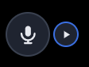
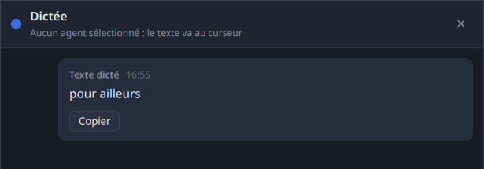

# Whisper — dictée flottante

Une icône ronde, toujours au premier plan. **Maintenez le clic** dessus, parlez,
relâchez : la voix est transcrite **en local** par [whisper.cpp](https://github.com/ggml-org/whisper.cpp)
et le texte est collé là où se trouve le curseur, dans n'importe quelle application.
C'est la dictée de l'icône compacte de Cockpit, seule.



- **Maintenir** : dicter (bip aigu = parlez, bip grave = fin).
- **Glisser** : déplacer l'icône (la position est retenue).
- **Bouton ▶ accolé** : lire à voix haute le texte sélectionné (ou le presse-papiers), en local avec [Pocket TTS](https://github.com/kyutai-labs/pocket-tts) (Kyutai).
- **Robots accolés** (optionnels) : des agents [Claude Code](https://claude.com/claude-code), un par dossier de projet, à qui parler par la dictée ; **VibeCoder** fait d'un agent un écran de développement qui suit le guide du dépôt, étape par étape.
- **Clic droit** : langue, micro, bip, son des autres applications, collage automatique, premier plan, affichage du texte, micro Discord, lecture à voix haute, dossier whisper, configuration, version (*À propos*), quitter.

À la fin d'une dictée, le **panneau** s'ouvre contre l'icône, sans prendre le
clavier, et montre le texte transcrit (contexte *Dictée*) : **Copier** le
remet dans le presse-papiers — par exemple pour le coller dans le champ d'un
agent qu'on avait oublié de sélectionner. Il suit l'icône quand on la déplace
et se ferme avec sa croix. C'est le même panneau que celui des agents : il
montre la conversation du robot sélectionné, ou la dictée si aucun ne l'est.
Désactivable : clic droit → *Afficher le texte transcrit*. Une petite bulle
reste pour les messages de l'appli (téléchargement, *Micro Discord coupé*) et
le volume.

L'icône, ses bulles et le panneau des conversations restent **au-dessus des
autres fenêtres**. Pour une vidéo en plein écran : clic droit → décocher
*Toujours au premier plan* ; ils redeviennent des fenêtres comme les autres.



L'icône ne prend jamais le focus : le texte arrive dans l'application active.
Le presse-papiers est restauré après le collage (sauf si le collage a échoué,
ou si le collage automatique est désactivé : le texte y reste, pour un Ctrl+V
manuel).

Pour qui modifie le code : [SPEC.md](SPEC.md) décrit le comportement attendu,
les invariants à ne jamais casser et les scénarios de non-régression.

## Installation

### Paquet autonome (recommandé)

Dans les [Releases](https://github.com/GearProductions/whisper/releases) :

- **Windows** : `whisper-dictation-<version>-win.exe`, exécutable portable, sans
  installation (il se décompresse à chaque lancement : quelques secondes).
- **Linux** : `whisper-dictation-<version>-linux.AppImage`, à rendre exécutable
  (`chmod +x`) puis lancer.

Le paquet contient l'appli, whisper-cli (accéléré sur toute carte graphique
par Vulkan, sinon sur le processeur) et `uv`. Les modèles, trop lourds pour le
paquet, se téléchargent **au premier usage**, une seule fois, dans les données
de l'appli (tableau ci-dessous) :

- **au premier lancement**, le modèle de dictée (548 Mo) ; une bulle et le
  menu en montrent l'avancement ;
- **à la première lecture à voix haute**, Pocket TTS et son Python (~400 Mo à
  télécharger, 1,2 Go sur le disque), puis ses modèles.

Paquets non signés : Windows affiche un avertissement SmartScreen (*Informations
complémentaires* → *Exécuter quand même*).

### Depuis les sources

```bash
npm install
npm start          # construit les pages et le principal (out/) puis lance l'appli
```

Pour qui modifie le code (règles : [AGENTS.md](AGENTS.md)) :

```bash
npm run typecheck                    # TypeScript des pages et du principal
npm test                             # tests (npm run test:invariants : les invariants seuls)
npm run test:front-diff -- v0.4.0    # pages comparées à une version : mêmes écrans, mêmes messages
npm run test:main-diff -- v0.5.0-rc.1  # appli réelle comparée à une version : mêmes résultats
```

### whisper.cpp (depuis les sources)

`npm run build:whisper` compile whisper-cli dans `resources/bin/` (git, cmake,
un compilateur C++ et le SDK Vulkan), comme le paquet ; il ne reste que le
modèle, téléchargé au premier lancement. Sinon, placez `whisper-cli`
(`whisper-cli.exe` sous Windows) et un modèle `ggml-*.bin` dans le dossier
whisper (clic droit → *Ouvrir le dossier whisper*) :

| OS      | Dossier                                    |
|---------|--------------------------------------------|
| Windows | `%APPDATA%\whisper-dictation\whisper\`     |
| Linux   | `~/.config/whisper-dictation/whisper/`     |

Le modèle se pose à la racine du dossier ; l'exécutable peut être jusqu'à deux
niveaux plus bas (`bin/Release/` d'une release Windows, `build/bin/` d'un build
Linux). L'exécutable et le modèle sont cherchés séparément : dans ce dossier,
puis dans `resources/bin/` (paquet), puis dans l'installation de **Cockpit**
(`…/cockpit/whisper/`).

### Collage sous Linux

Il faut un outil pour simuler Ctrl+V :

- **X11** : `xdotool` (`sudo apt install xdotool`)
- **Wayland** : `wtype` (Sway, Hyprland…) ou `ydotool` (avec son démon `ydotoold`)

Sans outil, le texte reste dans le presse-papiers. Note : la plupart des
terminaux Linux collent avec Ctrl+Maj+V, pas Ctrl+V.

Sous **KDE Plasma (Wayland)**, simuler une touche demande une autorisation
(« contrôle de la saisie ») à chaque collage, sauf à l'accorder une fois pour
toutes. Pour ne rien simuler du tout : clic droit → décocher *Coller
automatiquement là où est le curseur* (réglage `autoPaste`). Le texte dicté
reste alors dans le presse-papiers, à coller soi-même.

### Lecture à voix haute (Pocket TTS)

Le petit bouton ▶ à droite de l'icône lit le texte **sélectionné** dans
n'importe quelle application, ou le **presse-papiers** (au choix). Il est grisé
quand il n'y a rien à lire ; pendant la lecture il devient ■ : un clic arrête.

Sous **Windows**, qui n'a pas de sélection « primaire », le clic envoie Ctrl+C
à l'application active, lit le presse-papiers puis le rend tel qu'il était.
Le bouton ne peut donc pas savoir d'avance s'il y a une sélection : il reste
actif (« Rien à lire » sinon). L'historique du presse-papiers de Windows
(Win+V) garde une trace du texte lu.

Clic droit → *Lecture à voix haute* : source du texte, ou *Désactivée* pour
masquer le bouton ; *Volume…* ouvre un curseur à côté de l'icône, appliqué
aussitôt, y compris à une lecture en cours.

La voix est produite en local, sur le processeur, par
[Pocket TTS](https://github.com/kyutai-labs/pocket-tts) de Kyutai. S'il manque,
l'appli l'installe elle-même au premier clic sur ▶ (ou clic droit → *Installer
Pocket TTS*), avec `uv`, dans ses données : Python, Pocket TTS et PyTorch en
version processeur (~400 Mo à télécharger, 1,2 Go sur le disque). Rien n'est
installé dans le système. `uv` est livré avec le paquet ; depuis les sources,
`npm run fetch:uv` le télécharge dans `resources/bin/` (ou celui du système
sert). Une installation faite à la main sert aussi :

```bash
uv tool install pocket-tts==3.3.0 --index https://download.pytorch.org/whl/cpu
```

Les modèles se téléchargent à la première lecture (cache Hugging Face).

L'audio arrive au fil de la génération : la lecture commence ~0,1 s après le
clic. Le modèle se charge au survol du bouton (~3 s, ~1,5 Go de mémoire par
langue) et se décharge après 10 min sans lecture.

**Langues et voix.** Le texte est lu en français ou en anglais, selon la
langue détectée sur l'ensemble du texte (clic droit → *Langue du texte* pour
l'imposer). La voix française dit très bien les termes techniques anglais.
Trois voix par langue, fournies par Kyutai (clic droit → *Voix française* /
*Voix anglaise*) : Estelle, Mary, Marius (homme) ; Jane, Anna, Alba (homme).
Toutes sous licence libre (CC0 ou CC-BY 4.0) ; le clonage d'une autre voix
demande des poids à accès restreint, non utilisés ici.

Sous **Wayland**, il faut aussi `wl-paste` (paquet `wl-clipboard`) : le
compositeur ne donne la sélection qu'à la fenêtre qui a le focus, et l'icône
ne le prend jamais. Dans une distrobox, celui de l'hôte est utilisé.

### Agents Claude Code

Clic droit → *Agents Claude Code* → *Afficher les agents* (désactivé par
défaut). Il faut [Claude Code](https://claude.com/claude-code) installé et
connecté sur la machine : l'appli lance **le vôtre** (rien d'embarqué, pas de
clé API).

Un agent est une conversation Claude Code attachée à un **dossier de projet**
(un seul par dossier), représenté par un petit robot à droite de l'icône :

- **« + »** : un nouvel agent, dans un **dossier favori** (déjà choisi une
  fois, sans agent pour l'instant) ou dans un dossier à choisir, qui devient
  favori. Le nouvel agent est sélectionné ; panneau ouvert, il y affiche sa
  conversation. Chaque **dossier** reçoit une couleur au hasard, qu'il garde : son
  robot, le liseré du micro et son panneau la portent.
- **Worktrees** : les agents d'un même dépôt git forment une famille,
  reconnue toute seule. L'agent du dossier principal est le parent ; l'agent
  d'un autre worktree du dépôt, un **robot enfant**, plus petit, rangé sous
  lui, avec une pastille : sa branche (ou « PR #n »). Clic droit sur le
  parent → *Worktrees* : les worktrees du dépôt qui n'ont pas d'agent, chacun
  avec *Ouvrir un agent ici* (un dossier jamais choisi passe par la question
  de confiance) ; l'enfant porte le nom de sa branche et la couleur du parent.
  C'est un agent comme un autre ; il reste jusqu'à ce qu'on le retire, et
  retirer le parent ne le retire pas.
- **Clic sur un robot** : il est sélectionné (à la couleur de son dossier). La dictée du gros bouton
  lui est alors **destinée** au lieu d'être collée. Un second clic le
  désélectionne.
- **Le panneau de conversation** : la conversation de l'agent, dans un panneau
  **attaché à l'icône** (le même que celui de la dictée ; il la suit quand on la
  déplace, et reste au-dessus des autres fenêtres, voir *Toujours au premier
  plan*). Deux tailles :
  - **réduit** : le dernier échange — votre dernier message, sa réponse (avec
    **▶ Écouter**) ; à la hauteur de son contenu ;
  - **agrandi** (**⤢**, et **⤡** pour revenir) : tout le fil, ouvert en bas
    sur le dernier échange, et l'**🕘
    Historique** des conversations passées du dossier (de l'appli comme celles
    lancées dans un terminal), par intitulé et date. Une ancienne conversation
    s'y lit, en lecture seule ; *← Conversation en cours* y revient ;
    *Reprendre cette conversation* en refait la session en cours — celle
    qu'elle remplace reste dans l'historique, comme après *Nouvelle session*.
    Redimensionnable par ses bords (la taille est retenue).

  **×** le ferme. Chaque conversation porte son **intitulé** (celui que lui
  donne Claude Code) ; chaque message, son **heure**. Pendant que l'agent
  travaille, le fil le suit et l'anime (avec le temps écoulé). Les **liens**
  s'ouvrent dans le navigateur. Les **pièces jointes** de vos messages se
  voient : aperçu des images (clic : en grand), fichiers (clic : montrés dans
  le gestionnaire de fichiers), texte sélectionné (à déplier).
- **Le champ de saisie**, en bas du panneau, réduit ou agrandi : **la dictée
  vers l'agent y arrive** (le panneau s'ouvre en réduit au besoin), à relire,
  compléter, envoyer (**Entrée** : le message s'affiche aussitôt dans le fil ;
  **Maj+Entrée** va à la ligne ; un brouillon par agent). Sans parler (micro indisponible, lieu calme) : clic droit sur le
  robot → *✎ Écrire un message…*. **Pièces jointes** : glisser-déposer ou
  **Ctrl+V** (images envoyées à Claude — réduites au-delà de 1568 px —, autres
  fichiers par leur chemin, que l'agent lit lui-même) ; **📎** : choisir des
  images ou fichiers, ou joindre le **texte sélectionné** (Linux, aperçu dans le
  menu ; sous Windows, collez-le dans le champ). Pendant que l'agent travaille,
  on écrit mais on n'envoie pas. *Agents Claude Code* → *Relire avant
  d'envoyer* décoché : la dictée part aussitôt.
- **Commandes de Claude Code** : un champ qui commence par **« / »** propose les
  commandes de l'agent — celles de Claude Code (`/compact`, `/context`…), ses
  skills, celles du projet —, avec leur description ; flèches, Entrée ou Tab
  pour choisir. Le message part comme si on l'avait tapé dans Claude Code.
- **Jauge du contexte** (en-tête du panneau) : la part de la fenêtre de
  contexte occupée (orange à 80 %, rouge à 90 %). Un clic : le détail, par
  catégorie (instructions, outils, skills, fichiers de mémoire, messages…), et
  **Compacter (/compact)** pour résumer la conversation et libérer de la place.
  La mesure vient de la dernière réponse ; le détail, de Claude Code, lancé le
  temps de répondre (la conversation n'en est pas touchée).
- **Pendant qu'il travaille**, le robot clignote. **« ? »** : il demande une
  autorisation (mode manuel) — dans son panneau, *Autoriser*, *Toujours
  autoriser*, *Refuser*. Rien d'affiché : son panneau s'ouvre en réduit, sans
  prendre le clavier ; on lit autre chose : le « ? » du robot attend qu'on
  clique. **Pastille verte** : il a répondu ; un clic ouvre son panneau.
- **Les robots servent d'onglets** : une conversation à la fois, celle du
  robot sélectionné ; panneau ouvert, cliquer un robot y affiche la sienne (et
  le sélectionne). Un second clic sur le robot affiché rend la dictée au
  curseur, et le panneau passe au contexte *Dictée*.
- **Bureaux virtuels** : le panneau prend le clavier (on y écrit), donc le
  gestionnaire de fenêtres le range sur un bureau. Sous KDE : Alt+F3 → *Sur
  tous les bureaux* — fermé (×) puis rouvert par un clic, il garde ce
  réglage ; rouvert de lui-même (dictée, demande d'autorisation), il revient
  sur le bureau courant sans prendre le clavier, et l'oublie.
- **Clic droit sur un robot** : couleur du dossier, modèle, effort, mode
  (manuel, accepter les modifications de fichiers, auto, plan), *✎ Écrire un
  message…*, *Dernier échange*, **conversation complète** (et historique), interrompre, *Nouvelle
  session* (repartir de zéro), retirer (son dossier reste favori). Le **mode** et le **modèle**
  changés pendant qu'il travaille s'appliquent aussitôt ; passer en *accepter
  les modifications* accorde la demande de modification de fichier en attente.
  En tête du menu, *Ouvrir sur GitHub — propriétaire/dépôt* ouvre la page du
  dépôt (grisé si le dossier n'a pas d'origine GitHub). *Ouvrir dans
  l'éditeur (zed)* ouvre le dossier dans une nouvelle fenêtre de l'éditeur de
  code (grisé si aucun n'est trouvé). *Ouvrir VibeCoder* : voir
  [VibeCoder](#vibecoder), plus bas.

**Entre deux messages**, l'agent garde son Claude Code lancé : ce qu'il a lancé
en arrière-plan (une commande, une surveillance) continue, et il vous prévient
quand c'est fini (pastille verte, comme une réponse). *Nouvelle session* ou
*Retirer* l'arrêtent, comme la sortie de l'appli. Chaque agent utilisé garde
ainsi un Claude Code en mémoire (quelques centaines de Mo).

**Tâches de fond** : tant qu'une commande en arrière-plan, une surveillance
ou un sous-agent tourne pour l'agent, son robot pulse lentement. Dans
l'en-tête du panneau, *⚙ Tâches (n)* ouvre un volet à droite du fil :
chaque tâche telle que l'agent la décrit, son état, son temps écoulé, sa
commande et, pour une commande, les dernières lignes de sa sortie
(*Montrer le fichier* la montre dans le gestionnaire de fichiers). Les
tâches finies restent jusqu'à la sortie de l'appli. Le volet ne fait rien :
pour arrêter une tâche, demandez-le à l'agent.

**Ce qui quitte la machine, ce à quoi l'on fait confiance.**

- La transcription reste locale, mais ce qui est dicté à un agent part chez
  Claude, comme tout message tapé dans Claude Code. Le robot sélectionné (et le
  liseré du micro à sa couleur) dit où ira la dictée ; au lancement de l'appli,
  aucun agent n'est sélectionné. Les pièces jointes (images, texte
  sélectionné) partent avec le message.
- Choisir un **nouveau dossier** demande confirmation : Claude Code y est lancé
  avec les réglages du projet (`.claude/` : hooks, serveurs MCP, autorisations),
  qui peuvent exécuter des commandes. N'ajoutez que des dossiers connus.
- La demande d'autorisation (dans le panneau) montre la commande ou le fichier **en entier, tel
  quel** : c'est ce texte qui est autorisé. *Toujours autoriser* n'apparaît que
  si Claude Code propose une règle, l'affiche, et ne vaut que **pour la session
  en cours** — rien n'est écrit dans les réglages du projet ou de l'utilisateur.
- Les modes *accepter les modifications* et *auto* ne demandent plus rien (ou
  presque) : à réserver aux dossiers sous git.

**Réponse écrite et réponse orale.** Chaque réponse de l'agent se termine par
un bloc `<audio>…</audio>` : un résumé court, sans formatage, fait pour
l'oreille. Le panneau montre la réponse sans ce bloc ; ▶ ne lit que lui, avec le
moteur de lecture à voix haute. La consigne n'est ajoutée qu'aux sessions
créées par l'appli : vos sessions Claude Code habituelles ne changent pas.

Cette consigne est un fichier, `consigne-agents.md`, à côté de `config.json` :
clic droit → *Agents Claude Code* → *Modifier la consigne des agents* l'ouvre
dans votre éditeur. Relue à chaque message ; supprimée, elle revient par
défaut ; vidée, plus de consigne (▶ lit alors la réponse entière).

**Commande de lancement** (réglage `agentCommand`, clic droit → *Agents Claude
Code* → *Changer la commande de lancement…*) : vide, c'est `claude`. À régler
quand les outils du projet vivent ailleurs — l'appli ajoute ses arguments
derrière :

```json
"agentCommand": "distrobox enter dev -- mise exec -- claude"
```

La commande doit transmettre l'entrée et la sortie standard telles quelles,
c'est par là que l'appli dialogue avec Claude Code : pas de shell de connexion
(`bash -lc …`), dont les scripts de profil consomment l'entrée.

**Éditeur** (réglage `editorCommand`, clic droit → *Agents Claude Code* →
*Changer d'éditeur…*) : vide, c'est le premier trouvé parmi `zed`, `code`,
`cursor`, `codium`, ouvert dans une nouvelle fenêtre (`-n`). Réglé, la
commande est lancée telle quelle, le dossier en dernier argument (ajouter
`-n` pour une nouvelle fenêtre) :

```json
"editorCommand": "flatpak run com.visualstudio.code -n"
```

**Autorisations en série, interruption, journal.**

- Plusieurs demandes d'autorisation peuvent arriver à la fois (l'agent lance
  des outils en parallèle) : elles attendent en file, le panneau les montre
  l'une après l'autre (« 1 autre en attente ») et chaque clic ne répond qu'à
  celle affichée. Une demande sans réponse bloquerait l'agent indéfiniment.
- *Interrompre* demande à Claude Code d'arrêter son tour, ce qui arrête aussi
  la commande en cours. Tuer le processus ne suffirait pas : avec une commande
  de lancement comme `distrobox enter …`, seule l'enveloppe mourrait, et Claude
  Code continuerait seul dans le conteneur. Il n'est tué qu'en dernier recours,
  s'il n'a pas obéi en 5 s. Quitter l'appli attend de même que les agents
  aient arrêté.
- Clic droit → *Agents Claude Code* → *Ouvrir le journal des agents*
  (`agents.log`, à côté de `config.json`) : début et fin de chaque tour, chaque
  demande d'autorisation, sa réponse et son délai, les interruptions. Une
  demande qui n'a pas pu aboutir y est notée **ÉCHEC**, et la réponse de
  l'agent le signale par un ⚠.

### VibeCoder

Pour développer avec un agent en suivant le guide
[*Développer avec l'IA*](docs/dev_guide/guide-travail-dev-ia.html) sans tout
lui redire à chaque étape (« fais la note », « c'est bon, commit et passe au
suivant », « replie les fixups et sors la PR ») : VibeCoder remplace la
conversation d'un agent par un écran de développement, qui montre où en est
le travail et propose, à chaque étape, les boutons qui envoient à l'agent le
bon message, avec le bon skill et le bon modèle. Deux usages : **Créer** une
feature sur la branche du dossier de l'agent, ou **Relire** une PR du dépôt.

**Ouvrir.** Clic droit sur un robot → *Ouvrir VibeCoder* ; pour revenir,
*Revenir à la conversation* (même menu, ou 💬 en haut de l'écran). Le choix
est retenu pour chaque agent : l'un peut rester en VibeCoder, l'autre en
conversation ; cliquer un robot montre sa vue. Le panneau s'agrandit
(1280 × 820 la première fois, redimensionnable, taille retenue à part de celle
de la conversation). Il faut un dossier sous git, à la racine du dépôt, et ses
notes de ticket sous `docs/tickets/` ; sans dépôt, l'écran le dit et la
conversation reste utilisable.

**L'écran.**

- en haut : l'agent et sa branche ; *Créer* / *Relire* ; *Guide* / *Vibe* ;
  *FR* / *EN* ; ↻ (relire le dépôt tout de suite) ; 💬 ; × ;
- à gauche, le **parcours** : les étapes (point plein : faite ; anneau : en
  cours ; gris : à venir), chacune avec ses faits en une ligne, puis les
  commits de la branche. Il mène : un clic (ou Ctrl+1…6) ouvre une étape
  faite, pour revenir en arrière, ou celle en cours ; une étape à venir
  reste visible, sans clic (en *Relire*, toutes s'ouvrent) ;
- au centre, l'étape choisie — la note du ticket, ce
  que les skills ont produit —, sous son titre son **champ** (quand une de
  ses actions prend un texte) et ses actions (celle qui fait avancer l'étape
  en cours en tête, discrètement mise en avant) ; chaque carte produite par
  un skill a son *Relancer* ;
- à droite, quatre onglets : la **conversation** de l'agent, comme d'habitude
  (fil, autorisations, champ, dictée, commandes « / » ; au-dessus du champ,
  *Demander sans modifier* : il répond sans rien toucher), les **Actions**
  lancées, ses **Tâches** de fond et les **Processus** du projet (le nombre
  en cours dans l'onglet) ;
- en bas : modèle, effort et mode de l'agent (comme dans son menu), jauge du
  contexte, *⚙ Tâches* (l'onglet), *⏹ Arrêter* quand la conversation
  travaille, fichiers modifiés, heure du dernier relevé.

L'écran se lit sur le dépôt, sans modèle : la branche, ses commits et ses
fichiers changés, la note du ticket (trouvée parmi ces fichiers d'après le
ticket — `G2-6675` — ou la version — `0.8.0` — que porte le nom de la
branche), ses tests
d'invariants, ce que les skills ont écrit. Il suit tout seul (toutes les 4 s,
et pendant que l'agent travaille).

**Les actions tournent à côté de la conversation.** Un bouton d'étape
(*Rédiger la note*, *Écrire les invariants (rouges)*, *Lancer les vérifications*…)
lance l'action dans **sa propre conversation**, avec son skill et son
modèle, comme si vous aviez tapé `/vibecoder:note fr … votre demande` : la
conversation de l'agent reste libre, vous lui parlez pendant ce temps. Un
bouton qui a besoin d'un texte — la demande de feature, du pseudo-code —
prend celui du **champ de son étape** : dictez-y (ou écrivez), puis
cliquez ; le champ se vide une fois l'action partie. Le champ de la
conversation ne sert plus qu'à elle (et à *Demander sans modifier*, *Où
j'en suis ?*) ; 💬 sur un passage (de la note, d'une relecture) l'y cite, à
compléter puis envoyer.

L'onglet **Actions** suit chaque action lancée : qui travaille, son état,
depuis quand, sa réponse ; ses demandes d'autorisation (*Autoriser*,
*Toujours*, *Refuser*). ⏹ (là, ou à côté du bouton) l'arrête à tout moment ;
vous choisissez ensuite **Garder** ce qu'elle a déjà écrit, ou **Annuler** :
les fichiers qu'elle a écrits — et eux seuls, pas les vôtres ni ceux d'une
autre action — reviennent à leur état d'avant (ce qu'elle a changé par une
commande, `git` ou un script, reste). Deux actions qui modifient la branche
ne tournent jamais ensemble, ni une relecture pendant une modification ; les
relectures et vérifications, elles, tournent ensemble. Une action n'est
finie que quand son travail l'est (ses sous-agents, la CI qu'elle attend) :
pas de limite de temps, ⏹ l'arrête. Quand ce qu'elle attendait se termine,
elle reste en cours 10 s : si l'agent repart en dire le résultat, elle finit
avec cette réponse ; sinon, au bout des 10 s (un agent qui repart plus tard
trouve l'action déjà finie). Un bouton qui doit
attendre est grisé et dit pourquoi ; un bouton qui n'a pas encore de sens
n'est pas affiché (pas de *✓ Commiter* sans commit préparé, pas de *Release
candidate* sans PR…) ; une action arrêtée retient les autres
tant que vous n'avez pas choisi. *⏹ Arrêter* de la barre d'état n'arrête
que le tour de la conversation.

La conversation est l'**orchestrateur** : elle est prévenue de la fin de
chaque action (une ligne dans le fil, pas pour une action que vous avez
arrêtée) ; demandez-lui « où en sont les actions ? », ou de lancer ou
d'arrêter l'une d'elles. Une action qu'elle lance et qui doit attendre part
d'elle-même dès que la voie est libre. En *Guide*, elle ne lance rien que
vous ne lui demandiez.

**Ouvrir dans l'éditeur.** *Ouvrir* sur la note, un module, un test (à la
ligne du cas : zed, VS Code, Cursor, VSCodium), un fichier d'un commit. En
*Relire*, la PR n'est pas sur votre disque : l'appli écrit le fichier tel
qu'il est dans la PR, en lecture seule, sous `vibecoder-out/<agent>/files/`,
et l'ouvre. Un commit : *Voir le diff* (de même, en lecture seule) ou
*GitHub ↗* (sa page, dans le navigateur).

**Créer** — les étapes du guide :

1. **Note** : *Rédiger la note* d'après la demande du champ de l'étape (sur la branche
   principale, l'agent crée d'abord la branche du ticket) ; ses questions
   ouvertes s'affichent à part, avec des réponses proposées : *Envoyer les
   réponses* (à l'action qui a rédigé la note : elle garde son contexte) ;
   puis ✓ pour valider la note.
2. **Forme** : *Poser la forme* (les modules et leurs contrats, dans la note,
   sans code) ; ✓.
3. **Invariants** : *Écrire les invariants (rouges), puis vérifier
   l'alignement*, d'après la note ou d'après le pseudo-code écrit dans le
   champ de l'étape — dans la même action, l'agent vérifie que note, forme
   et tests concordent, retouche les tests s'il y a des écarts (3 tours au
   plus) et dit ce qui reste (la carte de l'alignement) ; puis ✓ ou ✗ par cas
   (✗ le cite dans le champ, pour dire quoi changer), *✓ Tout valider* pour
   un fichier. *Lire en pseudo-code* aide à lire, sans être obligatoire :
   chaque cas de test traduit en étapes simples (`test "…":`, `given`,
   `when`, `then` — une ligne `then` par assertion), quel que soit le
   langage du test, avec ses cas limites, ce qu'il garantit, et un
   point d'attention s'il n'observe pas vraiment la propriété ; *Code* montre le code
   d'origine du cas à la place du pseudo-code, *Voir le fichier* le fichier
   entier, colorés comme sur GitHub (TypeScript / JavaScript, Rust, Python,
   Go ; un autre langage : sans couleurs) ; *Relire* un fichier
   (ou *Tout relire*) refait sa lecture ; *Préparer le commit* puis *✓ Commiter*.
   Une note sans ligne « → invariant » passe l'étape tout de suite (pas de
   test à écrire, *Écrire les invariants* n'est pas proposée) : la note et la
   forme se commitent à l'étape Modules.
4. **Modules** : *Générer ce module* (avec `ponytail`, tests lancés, sans
   commit), *Relire le diff*, *✓ Valider → commit → suivant* ; ou *Générer
   les modules restants* (en parallèle, chacun relu et commité à part).
5. **Revue** : *Lancer les vérifications et la ponytail review* (les deux
   tournent ensemble ; des avertissements seulement : en orange, la
   vérification passe ; pour refaire l'une, on relance ce bouton ; les
   commandes du projet sont vraiment lancées, par le préfixe des commandes,
   et un résultat d'avant ce lancement ne compte pas), *Tout appliquer* ou
   *Appliquer* une remarque (en fixups), *Replier les fixups* ; la liste du
   guide avant une PR, cochée quand le dépôt le dit — « chaque diff relu » et
   « AGENTS.md à jour » se cochent à la main, jusqu'au prochain commit.
6. **PR** : sans PR, *Valider la feature (ouvrir la PR)* ; la PR ouverte,
   *Diagnostiquer la CI* et *Release candidate* ; fusionnée, *PR mergée →
   revenir sur la base* et *Release officielle*. L'étape est faite dès qu'une PR existe pour la branche :
   l'appli la demande elle-même à `gh` (sans IA, en lecture seule ; toutes
   les 60 s au plus, ↻ pour tout de suite).

**Sans IA** : *✓ Commiter*, *Charger* (une PR), *Publier la revue* et *PR
mergée → revenir sur la base* ne sont que des commandes connues : l'appli
les lance elle-même (bouton « direct », aucun jeton) — `git commit -F` du
message affiché ; `gh pr view` puis `git fetch` de la PR ; `gh pr review`
du brouillon ; et, seulement si la PR est fusionnée, `git switch`, `git pull
--ff-only`, `git branch -d`. Le résultat s'affiche sous le bouton (✓ ou ✗,
le détail à déplier), chaque commande dans `direct.log` des sorties de
l'agent ; git et `gh` passent par le préfixe des commandes (la box : les
hooks de commit y trouvent Node). En cas de souci, le petit *via* à côté
passe par l'agent, comme avant.

Une validation vaut pour le contenu validé : une note modifiée ensuite
repasse « modifiée depuis », à revalider. Quand l'étape n'attend plus que
votre ✓, l'étape vous le dit (*✓ Valider la note*, « N cas à valider »). Les lignes de la note que
l'agent vient de changer sont surlignées (*Voir les modifications* : le
diff ; *Vu* : ne plus surligner).

**Relire** — une PR : son numéro ou son lien, puis *Charger* ; ou *Mes PR à
relire* (celles où l'on vous demande, que l'appli demande à `gh`, sans IA)
et un clic sur l'une d'elles ;
*Décharger la PR* pour en choisir une autre. Elle est
récupérée à part (`refs/vibecoder/pr/<n>`) : votre copie de travail ne bouge
pas. Puis la note (*Relire la note* : les décisions à discuter), les
invariants (les mêmes cartes en pseudo-code), les commits (*Relire les
commits* — ou, sans IA, la liste des commits, leurs fichiers, leur diff —,
une carte par commit), le plan de test (*Plan de test à l'écran* : des cases
à cocher pendant l'essai). ✗ et 💬 ajoutent une remarque au **brouillon de
revue** (un par PR) : le texte du champ, sinon ce qu'on cite ; elle se
modifie sur place, × la retire. Une PR déjà fusionnée ou fermée se charge,
mais il n'y a rien à relire : l'écran le dit (son état est redemandé à `gh`
toutes les 60 s au plus). Enfin le verdict (*Commenter* par défaut, *Approuver*, *Demander
des changements*) et *Publier la revue*, qui l'envoie sur GitHub telle
quelle.

Pour lancer la PR, ou la relire à côté de votre travail : *Ouvrir dans un
worktree*. L'agent crée un worktree de la PR comme le projet le fait
d'habitude (son skill, son script ou sa doc de worktrees ; sinon à côté du
dépôt, `<dépôt>-worktrees/pr-<n>`) et le prépare (dépendances…). L'appli
vous demande alors si vous faites confiance à ce dossier — les réglages
`.claude` de la PR, écrits par son auteur, se chargeront —, puis ajoute un
robot « PR #n » sur ce dossier, sous celui du dépôt, déjà en *Relire* :
*Aller au robot PR #n*.
Sur ce robot, *Décharger* demande à l'agent du dépôt de retirer le worktree
(refusé s'il reste des modifications) ; le robot part avec lui, et votre
brouillon de revue revient à l'agent du dépôt.

**Lancer le projet.** L'onglet *Processus* lance, arrête et relance les
commandes qui font tourner le projet de l'agent (serveur, front, services) :
le nom de chacune, sa commande en petit dessous, ▶, ⏹, ↻, son état, depuis quand, et la fin de son journal (à
déplier ; *Journal complet* dans l'éditeur). Les commandes sont à vous, propres
à la machine (`vibecoder/projets/<dossier>.json`) : *Proposer les commandes*
(Haiku lit le README, `package.json`, `process-compose`, vos alias et
fonctions du `.bashrc`…) les écrit s'il n'y en a pas encore ; *Modifier les
commandes* ouvre le fichier. Chacune passe par `bash -ic` (vos alias et
fonctions marchent : `gear` pour gt-plugins), dans la box de l'agent si sa
commande passe par `distrobox enter <box> --`. Autre chose devant (une
autre box, `toolbox run`, rien) : le réglage `vibeCommandPrefix`, ou
`"prefix"` dans le fichier du projet (`""` : rien), qui l'emporte ; le même
préfixe sert aux appels de l'appli à `gh` (l'AppImage tourne sur l'hôte,
`gh` est souvent dans la box). C'est l'appli qui lance :
quitter l'appli arrête tout ce qu'elle a lancé, et rien d'autre. L'agent lit
les mêmes journaux et peut demander l'arrêt ou la relance d'une commande (il
écrit un petit fichier que l'appli exécute, VibeCoder affiché). Un robot
enfant reprend les commandes de son parent et les lance dans son propre
dossier ; une commande ne tourne qu'à un endroit de la famille (ports et
base partagés ; le parent retiré, ses enfants restent une famille) : la lancer ailleurs demande « <nom> tourne dans <branche> :
l'arrêter et le lancer ici ? ».

**Guide ou Vibe.** *Guide* (par défaut) : vous validez la note, la forme et
chaque invariant ; l'étape en cours attend vos ✓. *Vibe* (*Créer*
seulement) : vous donnez la main à l'agent, vous testez et approuvez à la
fin. Plus rien n'attend vos ✓, et l'écran change : un **fil d'Ariane** (les
étapes faites, en cours, à venir, sans clic) à la place du parcours, la zone
*Vibe* (et, la PR fusionnée, *PR mergée → revenir sur la base* et *Release
officielle*), puis la note. En deux temps :

1. la demande dans le champ, *Rédiger la note* ; l'agent vous pose
   **toutes** les questions de la note (*Envoyer les réponses*) — il n'en
   tranche aucune ;
2. *Valider et développer* : l'agent reprend à la première étape pas faite et tient le rôle du
   développeur du guide jusqu'à la PR et la release candidate en
   **enchaînant lui-même les actions de l'écran** — les mêmes que vous
   lanceriez, visibles et arrêtables dans l'onglet *Actions* (modules
   confiés à des agents Opus en parallèle) —, ne s'arrête que sur une
   question qui bloque, ne choisit jamais *Garder* / *Annuler* à votre
   place, et le fil d'Ariane se remplit sous vos yeux. Il ne fusionne pas
   la PR et ne publie pas de version officielle.

**Qui travaille, ce que ça coûte.** Chaque bouton dit qui travaille :
*haiku*, *sonnet · moyen*, *opus · élevé*… ou *agent* (le modèle de l'agent).
Ce qui se suffit à soi-même tourne à part, sans relire la conversation : son
prix ne dépend pas de la longueur de celle-ci (≈ 0,02 $ sur Haiku : lister ou
charger une PR, lancer les vérifications, commiter, publier une revue).
Sonnet prépare un commit, ouvre la PR, replie les fixups, diagnostique la CI,
écrit le plan de test, lit les invariants en pseudo-code (une lecture n'est
refaite que si le test change). Opus, effort élevé, écrit les invariants,
génère un module, relit un diff, une note ou des commits, vérifie
l'alignement, fait la ponytail review. Sur le modèle de l'agent, chacune
dans sa conversation : la note, la forme, les réponses aux questions,
*Appliquer la revue*, *Générer les modules restants*, les releases ; dans
la conversation : *Valider et développer* — ce dernier, *Générer les modules
restants* et les releases, longs et coûteux. Pour une étape qui tourne à
part, vous pouvez choisir un modèle plus léger (ou plus fort) que le conseillé,
le temps d'un clic : VibeCoder génère pour cela une variante de chaque skill
(`<nom>--haiku`, `--sonnet`, `--opus`). VibeCoder ne passe jamais un
agent sur Fable de lui-même : vous seul le faites (menu du robot, barre
d'état, ou la pastille *✦ Fable · élevé* des étapes Note et Forme, pour les
rédiger avec le plus de soin — plus cher).

**Les skills.** Les boutons s'appuient sur un plugin, `vibecoder`, que l'appli
donne à Claude Code : ses skills (`/vibecoder:note`, `/vibecoder:relire`…)
servent à tous les agents sans rien écrire dans vos projets, et ne coûtent
rien tant qu'on ne les appelle pas. Ils suivent les skills de votre projet ou
les vôtres quand ils existent (`gear-prompt-specs-to-feature-note`,
`gear-commit-message`, `gear-fix-up`, `ponytail`, `ponytail-review` ; avec
`gear-guide`, un bouton *Où j'en suis ?*), sinon le guide du dépôt. Ce qu'ils
produisent pour l'écran va dans `vibecoder-out/`, à côté de `config.json` :
un dossier par agent ; quand l'agent change de branche, ce qui a été produit
pour l'ancienne est mis de côté (`branches/`) et revient avec elle.

**Personnaliser.** Clic droit sur l'icône → *Agents Claude Code* → *Dossier
de VibeCoder* (`vibecoder/`, à côté de `config.json`) : `actions.fr.json` et
`actions.en.json` (les boutons : libellé, aide, message envoyé ; à modifier,
retirer, ajouter — mais pas l'`id` d'un bouton livré, sur lequel l'écran
s'appuie), `plugin/skills/<nom>/SKILL.md` (un skill : ses
instructions, son modèle, son effort) et un `README.md` qui détaille tout. Un
fichier que vous avez modifié n'est jamais remplacé, même par une nouvelle
version de l'appli ; un fichier jamais modifié suit les mises à jour. **Pour
revenir à l'origine, supprimez le fichier** : il revient au prochain
lancement (ou en rouvrant le dossier par le menu). Un fichier d'actions
illisible : les boutons d'origine ; vide (`[]`) : aucun bouton.

**FR / EN** (en haut de l'écran ; réglage `vibeLang`) : la langue de l'écran,
des boutons et des messages envoyés — l'agent écrit dans cette langue la
note, ses questions, le plan de test, la relecture de la note. Ce qui touche au
code reste en anglais : le pseudo-code des invariants, les relectures de diff
et de commits, la ponytail review, la CI, les vérifications (les messages de
commit et de PR suivent la convention du projet). Pour tous les agents. La conversation elle-même (fil,
champ) reste en français.

**Limites.** La note n'est trouvée que si le nom de la branche porte le
ticket ou la version, et que la branche la change (ou la crée). Les actions
lancées ne survivent pas à un redémarrage de l'appli ; *Annuler* une action
suppose que Claude Code reçoive le suivi des fichiers à travers sa commande
de lancement (une box : la variable d'environnement doit passer). Non essayé
sous Windows.

### Son des autres applications

Sur haut-parleurs, une vidéo ou un appel seraient captés par le micro et
transcrits avec la dictée. Clic droit → *Couper le son des autres applications
pendant la dictée* (désactivé par défaut) : leur son est coupé le temps de
l'enregistrement, puis rétabli. Les bips de l'appli restent audibles ; une
application déjà muette le reste. Même mécanisme que pour le micro Discord
ci-dessous (PipeWire sous Linux, Core Audio sous Windows).

Un son ou le micro Discord resté coupé (par exemple après un arrêt brutal de
l'appli) : clic droit → *Rétablir le son et le micro Discord (dépannage)*.
Sous Linux, une application dont le son s'est arrêté pendant la dictée
retrouve d'elle-même le son quand elle rejoue (WirePlumber retient la
coupure de chaque application ; l'appli la lève).

### Micro Discord

Clic droit → *Autoriser la coupure du micro Discord* (désactivé par défaut) :
en appel Discord, le micro est coupé le temps de l'enregistrement, puis
rétabli. Un micro déjà coupé le reste.

C'est le flux de capture de Discord qui est coupé, pas le bouton « muet » de
Discord : son icône ne change pas. À la place, une bulle *Micro Discord coupé*
s'affiche le temps de l'enregistrement, une fois la coupure confirmée.

- **Linux** : dans PipeWire, par `wpctl` (livré avec WirePlumber, installé
  d'office avec PipeWire).
- **Windows** : la session de capture de Discord, par l'API audio de Windows
  (Core Audio). Rien à installer.

## Configuration

`config.json`, à côté du dossier whisper (clic droit → *Modifier la configuration*) :

| Clé          | Rôle                                                              |
|--------------|-------------------------------------------------------------------|
| `lang`       | `fr`, `en`, `auto`…                                               |
| `vocabulary` | Mots propres à votre domaine, pour guider whisper (300 car. max) |
| `sound`      | Bips de début / fin                                               |
| `agentsEnabled` | Afficher les agents Claude Code                               |
| `agentCommand` | Commande qui lance Claude Code (vide : `claude`)               |
| `editorCommand` | Éditeur de code des agents (vide : `zed`, `code`, `cursor` ou `codium`, le premier trouvé) |
| `agents`     | Les agents : dossier, nom, modèle, effort, mode, session, parent d'un robot enfant (`parent`), vue et réglages VibeCoder (`view`, `vibe`) (gérés par l'appli ; `name` se modifie ici) |
| `agentFolders` | Dossiers favoris proposés par « + », chacun avec sa couleur    |
| `agentReview` | Dictée vers un agent : dans le champ de son panneau, à relire ; `false` : envoyée aussitôt |
| `onTop`      | Icône, bulles et panneau au-dessus des autres fenêtres            |
| `convSize`   | Taille du panneau agrandi (retenue au redimensionnement) |
| `vibeLang`   | VibeCoder : langue de l'écran et des messages envoyés, `fr` ou `en` |
| `vibeSize`   | Taille du panneau en VibeCoder (retenue au redimensionnement) |
| `vibeCommandPrefix` | VibeCoder : ce qui précède les commandes du projet et `gh` (vide : `distrobox enter <box> --` tiré de `agentCommand`, sinon rien) ; ex. `toolbox run -c dev` |
| `muteOthers` | Couper le son des autres applications pendant l'enregistrement   |
| `autoPaste`  | Coller le texte là où est le curseur ; `false` : il reste dans le presse-papiers |
| `showText`   | Panneau du texte transcrit (contexte *Dictée*) à la fin d'une dictée |
| `discordMute`| Couper le micro Discord pendant l'enregistrement                 |
| `speak`      | Bouton de lecture : `selection`, `clipboard` ou `off`             |
| `speakVolume`| Volume de lecture, de `0` à `1`                                   |
| `speakLang`  | `auto` (français ou anglais, détecté), `fr` ou `en`               |
| `speakVoices`| Voix par langue : `{ "fr": "estelle", "en": "jane" }`             |
| `size`       | Taille de l'icône en px (32–200, appliquée au redémarrage)        |

Relu à chaque dictée : pas besoin de relancer (sauf pour `size`).

## Paquets

Construits par la CI (`.github/workflows/ci.yml`) pour chaque nouvelle version.
Pousser un tag crée la Release :

```bash
git tag v0.2.0 && git push origin v0.2.0
```

La CI construit alors l'exe et l'AppImage (version prise sur le tag) et les
publie dans la Release GitHub de ce tag.

Pour essayer une version avant de la publier : un tag de **pré-version**
(`v0.3.0-rc.1`, depuis la branche de la PR). Même construction, mais la
Release est marquée pré-version : la version officielle (« Latest ») ne change
pas. Une fois validée et la PR fusionnée, le tag `v0.3.0` sur `master`.

Les PR ne font que les vérifications rapides ; *Actions* → *CI* → *Run workflow* construit les paquets sans rien
publier (artefacts).

En local, sur le système visé (`dist/`) :

```bash
npm run build:whisper && npm run fetch:uv   # binaires embarqués (resources/bin/)
npm run dist:linux                          # AppImage
npm run dist:win                            # exe portable (sous Windows)
```
